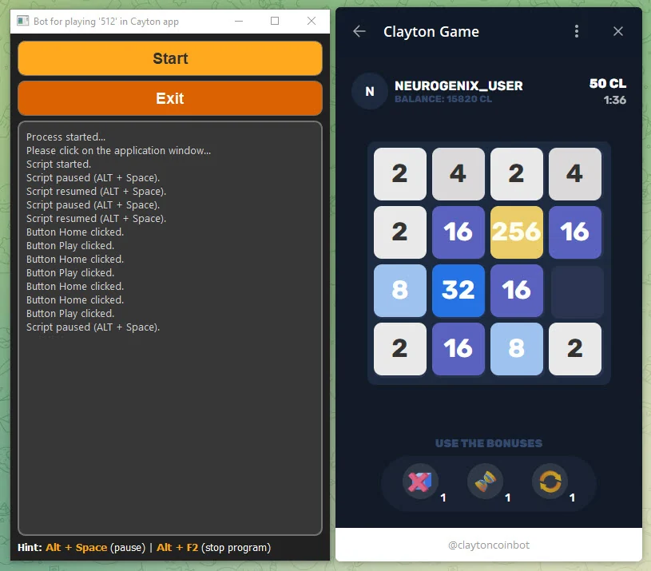

# bot_clayton_game

Приложение распознаёт элементы игрового окна Clayton с помощью набора детекторов dlib. По найденным кнопкам и числовым плиткам оно выбирает сценарий взаимодействия: запуск игры, возврат в меню или выполнение последовательности нажатий.

**Python-портфолио Евгения Толмачева** · Python · PyQt5 · dlib · mss · PyAutoGUI · NumPy



## Возможности

- Загружает отдельные детекторы плиток 2-256 и кнопок Play/Home в фоновом потоке.
- Захватывает целевое окно и разделяет найденные объекты по типам.
- Кликает по кнопкам и отправляет клавиши направлений при обнаружении игрового поля.
- Поддерживает паузу и остановку; прекращает обработку при длительном отсутствии детекций.
- Содержит вариант F5, в котором возврат через Home заменён однократным обновлением страницы.

## Как устроен проект

### Загрузка моделей

[`bot_clayton_game.py`](bot_clayton_game.py)

LoadDetectorsThread подготавливает SVM-детекторы и передаёт их в основное окно.

### Обработка состояния

[`bot_clayton_game.py`](bot_clayton_game.py)

process_image находит объекты, а capture_and_process выбирает действия для Home, Play и числовых плиток.

### Управление и альтернативный сценарий

[`bot_clayton_game.py`](bot_clayton_game.py), [`bot_clayton_game_F5.py`](bot_clayton_game_F5.py)

make_move отправляет нажатия клавиш. Вторая версия меняет поведение при обнаружении Home.

## Технологии и их роль

- **dlib**: Детекторы числовых плиток и кнопок интерфейса.
- **mss, NumPy и Pillow**: Получение кадров и преобразование изображений.
- **PyQt5 и потоки**: Интерфейс, загрузка моделей и фоновая обработка.
- **PyAutoGUI и pynput**: Отправка клавиш и обработка команд пользователя.

## С чего начать просмотр кода

Сравните два основных файла: в них видны общий цикл распознавания и разница сценариев управления. Детекторы загружаются из внешних SVM-файлов.

## Подготовка и запуск

Создайте отдельное окружение и установите исходные зависимости:

```powershell
python -m venv .venv
.venv\Scripts\Activate.ps1
python -m pip install -r requirements.txt
```

Проект ориентирован на Windows и управляет мышью/клавиатурой. Для полного запуска нужны локальные dlib-модели плиток и экранов игры (.svm), не включённые в репозиторий. bot_clayton_game_F5.py сохранён как отдельная авторская версия.

После подготовки настроек и необходимых данных основная точка входа:

```powershell
python bot_clayton_game.py
```

`requirements.txt` сохранён из проекта. Это снимок окружения, а не гарантия совместимости с новейшей версией Python. Для старых проектов могут потребоваться соответствующая версия Python и настройка системных компонентов.

## Структура

```text
bot_clayton_game/
├── docs/
│   └── preview.webp
├── .gitignore
├── bot_clayton_game.py
├── bot_clayton_game_F5.py
├── README.md
└── requirements.txt
```

## Контекст и ограничения

Проект 2024 года развивает сценарий экранной автоматизации: здесь несколько классов объектов и отдельные состояния интерфейса. Распознавание выполняют обученные детекторы; направления ходов перемешиваются случайно, без расчёта оптимальной игровой стратегии.

Проверены синтаксис Python-файлов и состав публикации. Полный запуск этой версии с внешними сервисами, локальными данными или моделями не выполнялся; команды выше описывают подготовку по исходникам.

## Состав репозитория

Сохранены авторские исходники, их имена и структура, зависимости и компактный скриншот. Рабочие базы, наборы данных, модели и виртуальные окружения исключены. Секреты заменены обозначениями `YOUR_...` / `REDACTED_...`; реальные значения задаются локально. Исходные алгоритмы при оформлении портфолио не перерабатывались.

Автор: [Евгений Толмачев](https://github.com/EvgenyET) · [Портфолио](https://evgeny.tech/)
